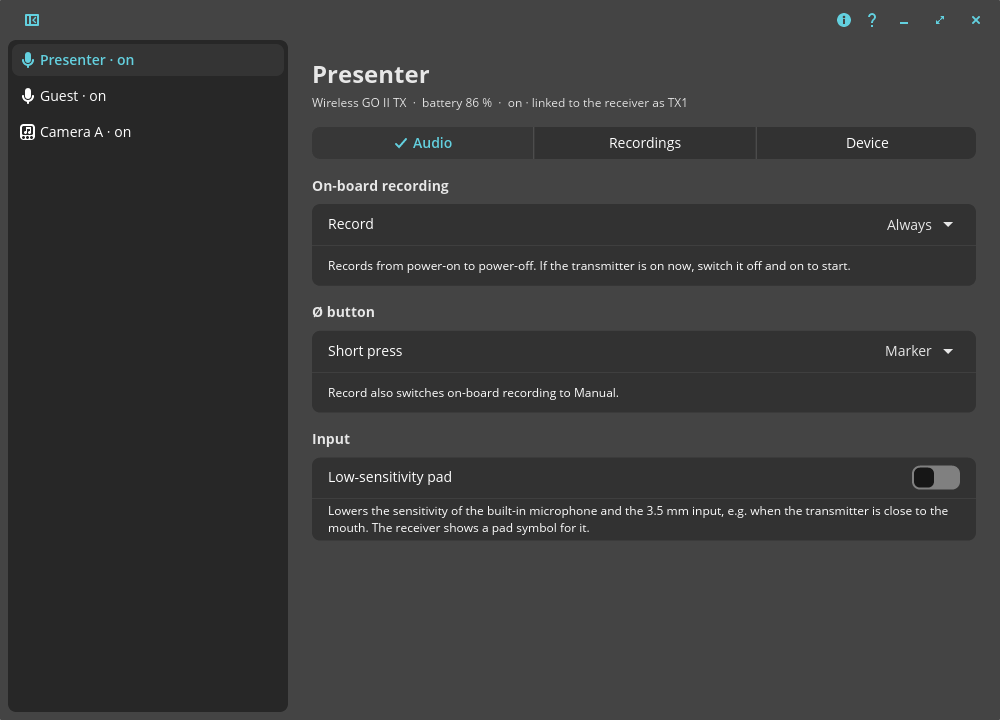
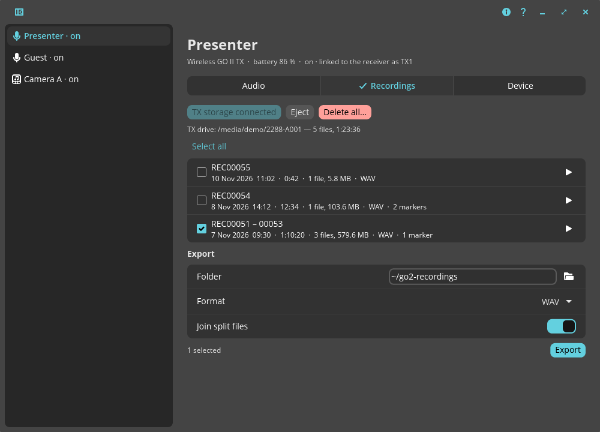
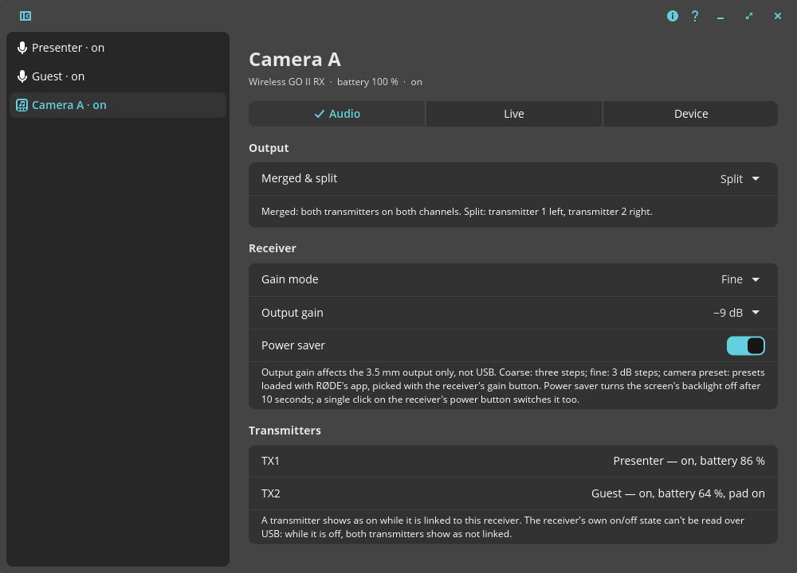
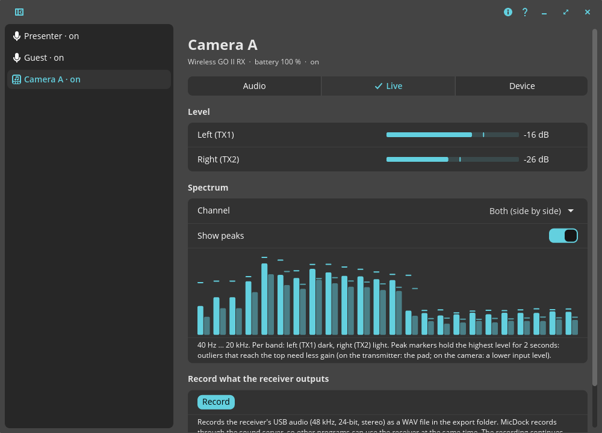
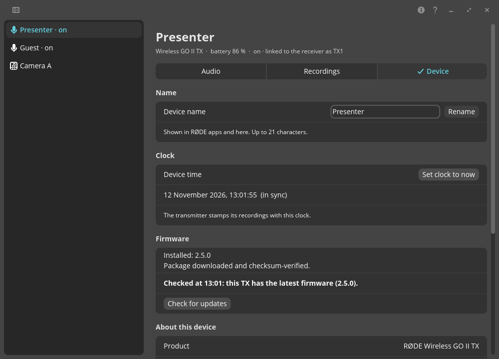
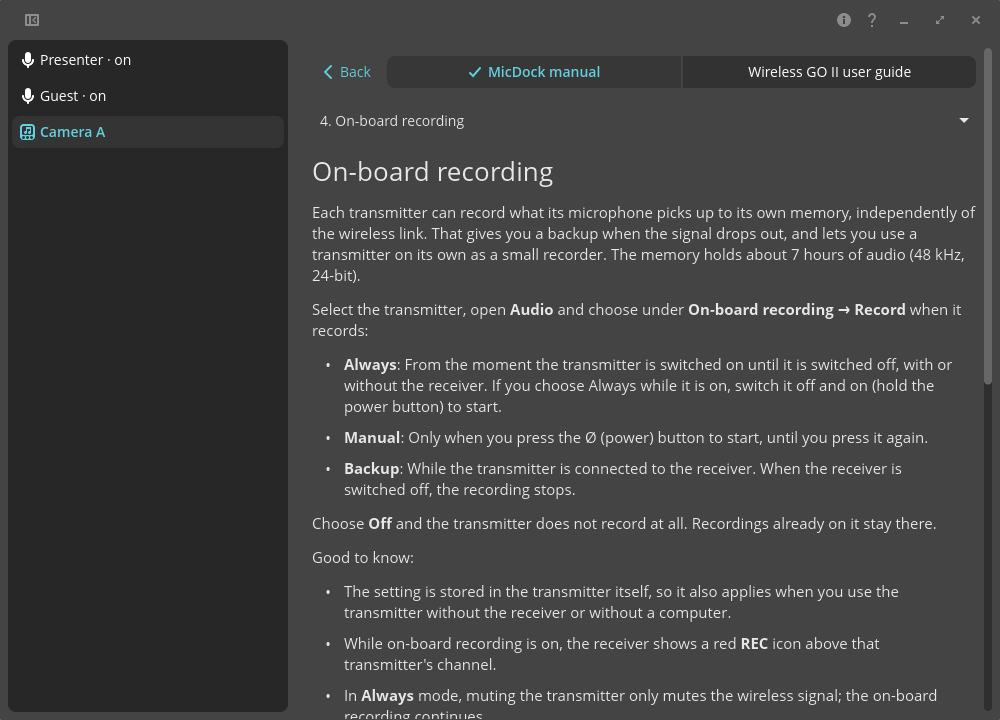

# MicDock manual

MicDock lets you manage a **RØDE Wireless GO II** on Linux: copy the recordings off the transmitters,
choose how they record, set the power button, switch the receiver between merged and split output,
rename the units, set their clocks and update their firmware.

MicDock is an unofficial project. It is not made, endorsed or supported by RØDE Microphones.

## Getting started

1. Connect a transmitter (TX) or the receiver (RX) with a USB cable and switch it on.
2. Start **MicDock** from your app menu, or run `micdock` in a terminal.
3. The connected units appear in the sidebar on the left. Click one to select it.

You can connect several units at once, for example both transmitters and the receiver.

If no unit shows up, see [Troubleshooting](#troubleshooting).

## The main window



- **Sidebar:** one entry per connected unit, with its name. Next to a transmitter it says whether it is **on**
  (linked to the receiver), **off** or a **USB drive** (storage mode). The sidebar button in the header bar
  hides and shows it.
- **Header bar:** the **About** button (version, licence, the unofficial notice) and the **Help** button (this
  manual and RØDE's user guide; also F1).
- **Tabs:** a transmitter has *Audio*, *Recordings* and *Device*; the receiver has *Audio* and *Device*.
  Each kind of unit remembers its last tab.

MicDock notices within a second when a unit is plugged in, unplugged or switched to USB storage mode.

## On-board recording

Each transmitter can record what its microphone picks up to its own memory, independently of the wireless
link. That gives you a backup when the signal drops out, and lets you use a transmitter on its own as a small
recorder. The memory holds about 7 hours of audio (48 kHz, 24-bit).

Select the transmitter, open **Audio** and choose under **On-board recording → Record** when it records:

- **Always**: From the moment the transmitter is switched on until it is switched off, with or without the receiver. If you choose Always while it is on, switch it off and on (hold the power button) to start.
- **Manual**: Only when you press the Ø (power) button to start, until you press it again.
- **Backup**: While the transmitter is connected to the receiver. When the receiver is switched off, the recording stops.

Choose **Off** and the transmitter does not record at all. Recordings already on it stay there.

Good to know:

- The setting is stored in the transmitter itself, so it also applies when you use the transmitter without
  the receiver or without a computer.
- While on-board recording is on, the receiver shows a red **REC** icon above that transmitter's channel.
- In **Always** mode, muting the transmitter only mutes the wireless signal; the on-board recording continues.
- In **Manual** mode the transmitter's LEDs light up from dim to strong when a recording starts and flash every
  5 seconds while it records. When you stop, they fade from strong to dim. Every start makes a new recording.
- Long recordings are split into files of about 31 minutes. MicDock shows them as one recording and can
  join them back together when you export.
- Set the transmitter's clock once (see [Device](#device)) so every recording gets the right date.

### The Ø (power) button

**Ø Button** sets what a short press on the transmitter's power button does:

- **Mute**: Mutes and unmutes the transmitter (default).
- **Marker**: Drops a marker into the on-board recording at that moment.
- **Record**: Starts and stops an on-board recording. This also switches On-board Recording to **Manual**.
- **None**: A short press does nothing.

Choosing another function than *Record* while the transmitter is in Manual mode switches on-board recording off,
because the button would no longer be able to start a recording.

### LEDs and recording format (transmitters)

**LEDs and recording format** on a transmitter's Audio page set its LED brightness (bright or dim) and, in
Backup mode, whether it records compressed (about 40 hours) or uncompressed WAV (about 7 hours). These go
through a receiver the transmitter is linked to, so the receiver has to be connected and switched on.

### Low-sensitivity pad (transmitters)

Under **Input** on a transmitter's **Audio** page, **Low-sensitivity pad** lowers the sensitivity of the built-in
microphone and of the 3.5 mm input — useful when the transmitter is close to the mouth (for example in an
Interview GO). The receiver shows a pad symbol for that transmitter. On the receiver itself: select the transmitter
with the pair button (∞) and hold the dB button.

## Getting your recordings



1. Select the transmitter and open **Recordings**.
2. Click **Connect TX storage** and confirm. The transmitter switches to USB storage mode and its recordings are
   listed. It stays in this mode until you unplug it or switch it off and on (hold the power button). Meanwhile
   it doesn't transmit to the receiver: the page and the sidebar say so.
3. Click **▶** next to a recording to listen to it in MicDock (play/pause, seek bar, markers).
4. Tick the recordings you want and export them (see below).
5. When you are done, click **Eject** and unplug the transmitter.

**The list** shows one line per recording, newest first, with its start date, length, number of files, size,
file type and markers (when you used the Ø button as *Marker*). A recording that was split into several
31-minute files is shown as one line.

**Playing:** a WAV recording plays straight from the transmitter; an older UGG recording is first converted
(that takes a moment).

**Markers:** when a recording has markers (the Ø button set to *Marker*), the player bar shows them as small ticks
under the seek bar and as a row of buttons, one per marker with its time; click one to jump there. The button of
the part you are listening to is highlighted. **⏮** and **⏭** next to the seek bar jump to the previous and next
marker; **⏮** within two seconds after a marker goes to the one before it, like a music player's "previous".

**Dates:** the transmitter stamps its files with its own clock. If that clock was never set, MicDock works out
the correct dates while the transmitter is connected and remembers the correction for those older recordings.

### Exporting

- **Folder:** where the files go (default `~/go2-recordings`); the folder button next to it opens it.
- **Format:** *WAV* is exactly what the transmitter recorded, without any loss. *MP3* files are much smaller
  (this needs `ffmpeg`).
- **Quality:** the MP3 quality. *VBR good* suits speech and most recordings.
- **Join split files:** write one file per recording instead of one per 31-minute piece.
- **Marker label file:** also write the markers to a `.txt` file next to each exported file (only for
  recordings with markers). In Audacity, *File → Import → Labels…* shows them as a label track.

Markers are always kept in the exported file itself: as cue points in a WAV file (shown by audio editors such as
Audacity, REAPER, Ocenaudio and Adobe Audition) and as chapters in an MP3 file (shown by podcast players and
media players that support chapters). In a joined export the markers of every piece are at the right place. They
are named *Marker 1*, *Marker 2*, …; an MP3 gets an extra chapter *Start* for the part before the first marker.

Click **Export**. A progress bar shows how far it is; **Cancel** stops it. The files are named after the date and time the recording started, for example
`2026-11-07 09.30 REC00051-REC00053.wav`, and keep that date. Files that already exist are skipped, so you can
export again after recording more.

### Deleting recordings

**Delete all…** (on the Recordings page of a transmitter) erases every recording on that transmitter, to make
room for new ones. MicDock asks first and you type *DELETE* to confirm, because this can't be undone: export
the recordings you want to keep first. The transmitter may restart for a moment afterwards.

Single recordings can't be deleted: the transmitter protects its drive against changes from the computer and
only offers to delete everything at once (RØDE's own app works the same way).

File types: firmware 2.50 and later records `.WAV` files; older firmware wrote `.UGG` files. MicDock reads both.
The `.EGG` files on the drive hold waveform previews for RØDE's app and can be ignored.

## The receiver



Select the receiver and open **Audio**. **Merged & Split Mode** sets how the two transmitters reach the
receiver's output:

- **Merged:** both transmitters are mixed together on the left and the right channel. The receiver shows one
  level meter. Use this with a single transmitter, or when your camera records both channels anyway.
- **Split:** transmitter 1 on the left channel, transmitter 2 on the right. The receiver shows two level meters.
  Use this for interviews, so you can edit and balance each person separately afterwards.

This is the same as holding both receiver buttons for 3 seconds, which also still works.

Under **Receiver** on the same page:

- **Gain mode:** **Coarse** (three steps: −24, −12 and 0 dB; the receiver shows a level triangle), **Fine** (−30 to
  0 dB in 3 dB steps) or **Camera preset** (presets loaded with RØDE's app; MicDock selects the default preset
  "WIGO2", the receiver's gain button cycles through the others).
- **Output gain:** the level of the 3.5 mm output in the chosen mode. It doesn't affect the USB output. The
  receiver's gain button changes the same setting; MicDock shows it within a few seconds.
- **Power saver:** when on, the screen's backlight turns off after 10 seconds without use. A single click on the
  receiver's power button switches it too.

Also under **Receiver**: **Ø button (single click)** chooses whether a click on the receiver's power button
switches the power saver or drops a marker into the transmitters' recordings, and **Safety channel** (Merged mode
only) adds a second channel 20 dB quieter on the 3.5 mm output, as a backup when the main one distorts.

Under **Transmitters** you see each linked transmitter — the receiver tells MicDock which are switched on, with
their battery level and firmware — and you can set it **through the receiver**, without connecting it to the
computer: **Record** mode, **Ø button**, **Recording format** (compressed recording holds about 40 hours instead
of 7, and is only possible in Backup mode), **Low-sensitivity pad** and **LEDs** (bright or dim). MicDock can't
see whether the receiver itself is switched on when it isn't a sound card: then no transmitter shows as linked.

### Live audio and recording (receiver)



The receiver is also a USB sound card — but only while it is switched on. Its **Live** tab shows what it outputs
over USB:

- **Level:** a meter per channel (in split mode: left = transmitter 1, right = transmitter 2) with the peak in dB.
- **Spectrum:** 24 bands from 40 Hz to 20 kHz, to see at a glance whether there is sound, hum or wind noise. In
  split mode each band has two bars, left (transmitter 1, dark) and right (transmitter 2, light); **Channel**
  shows one channel on its own. **Show peaks** marks the highest level of each band for 2 seconds, so short
  outliers stand out. A level meter that says **clip** reached full scale: lower the gain (the transmitter's
  low-sensitivity pad, or your camera's input level).
- **Record:** writes the receiver's USB audio (48 kHz, 24-bit, stereo) as a WAV file into the export folder,
  named after the date and time. The recording continues when you switch to another page; **Stop recording**
  ends it, and quitting MicDock closes the file properly too.

MicDock listens through your sound server (PipeWire or PulseAudio), not directly on the device, so other programs
— a video call, OBS, Audacity — can use the receiver at the same time. The output gain setting affects only the
3.5 mm output, not this USB audio.

MicDock also uses the sound card to tell whether the receiver is switched on: the sidebar and the header say
*on* or *off*.

## Device



- **Name:** give each unit a recognisable name, for example the name of the person who wears it. It is
  shown in MicDock and in RØDE's apps. Up to 21 characters.
- **Clock:** shows the unit's clock. **Set clock to now** sets it to your computer's time. Do this once for each
  transmitter so new recordings get the right dates.
- **Firmware:** shows the installed version and checks RØDE's update server for a newer one.
  **Download** fetches and verifies the update; **Install update…** installs it (see below).
- **About this device:** model, serial number and connection.
- **USB storage mode** (transmitters): shows whether the transmitter is a USB drive right now (its wireless is
  off then) and can switch it to that mode. Switching back is only possible on the transmitter itself: switch it
  off and on, or unplug it.
- **Parameter scanner:** for the curious. It reads every setting of the unit and highlights what changed
  since the previous scan.

### Firmware updates

The firmware comes straight from RØDE's update server and is checked against RØDE's checksum.

Before you install:

- charge the unit to at least 40 %,
- update one unit at a time and keep it connected until MicDock says it is finished.

MicDock's installer was built by studying how RØDE's own app updates the units. It has updated transmitters
and a receiver successfully, but it is not RØDE's software: you install at your own risk. If an update fails,
leave the unit connected and try again; it continues where it stopped. Every step is logged in
`~/.cache/micdock/firmware/logs/`.

## Appearance

MicDock follows your desktop's theme: light or dark mode, accent colour, rounding and fonts. On COSMIC this
happens automatically, including when you change the theme.

## User guides



- **MicDock manual** (this text, F1): installed with MicDock, always available offline.
- **Wireless GO II user guide:** RØDE's guide to the hardware: buttons, screen, connections, gain, battery
  and the charge case. MicDock downloads it from rode.com in the background and keeps a copy, so it also opens
  without an internet connection. Its chapters about RØDE's own app are left out, because this manual covers
  what MicDock does. The globe button opens RØDE's complete guide on rode.com; the refresh button downloads the
  latest version.

## What MicDock doesn't do (yet)

These settings and tools of RØDE's own app are not available in MicDock:

- editing recordings (waveform view, trimming, level adjustments), and renaming or deleting single recordings
  on the transmitter (deleting all of them is possible, see [Deleting recordings](#deleting-recordings)); use
  your audio editor after exporting,
- adding or editing camera presets,
- switching units on or off (RØDE's apps can't do that either).

Settings you made with RØDE's app stay in the units; MicDock leaves them as they are.

## Command-line tools

MicDock installs commands for scripts and terminals. Close MicDock while you use them.

**`ugg2wav`** converts recordings without the app:

```
# WAV files, one per recording piece
ugg2wav -o ~/go2-recordings /media/$USER/<drive>/REC*.WAV
# MP3, with the pieces of each recording joined
ugg2wav --mp3 --join -o ~/go2-recordings /media/$USER/<drive>/REC*
# also write each file's markers to an Audacity label file (.txt)
ugg2wav --join --labels -o ~/go2-recordings /media/$USER/<drive>/REC*.WAV
```

Markers are kept the same way as in the app: cue points in WAV, chapters in MP3.

**`rodego2`** talks to a unit directly. Find the unit's `/dev/hidrawN` with `rodego2 list` first:

```
# connected units
rodego2 list
# show or set the record mode: off, backup, always, button
rodego2 --dev /dev/hidrawN rec
# show or set the Ø button: mute, marker, none, record
rodego2 --dev /dev/hidrawN button
# show or set merged/split output (receiver)
rodego2 --dev /dev/hidrawN mode
# show or set the name
rodego2 --dev /dev/hidrawN name
# delete ALL recordings on a transmitter (asks you to type DELETE)
rodego2 --dev /dev/hidrawN erase
```

**`micdock-firmware`** checks for and installs firmware:

```
# latest version vs. the connected units
micdock-firmware check
# download and verify the latest firmware
micdock-firmware download
# dry run: show every step, change nothing
micdock-firmware plan tx
# install on the connected transmitter
micdock-firmware install tx
```

Each command shows all its options with `--help`.

## Troubleshooting

**A transmitter's power button doesn't react while it's connected to the computer.** Any communication with a
transmitter during a long press cancels the press. MicDock therefore reads transmitters only every 30 seconds
(and when you select one or change a setting); the receiver tells it in the meantime which transmitters are on.
If a press is missed, simply hold the button again. Other programs that talk to the units (the command-line tools
in a loop, an older MicDock) can cause the same.

**No unit appears.** Check that the unit is switched on and connected with a data cable (not a charge-only
cable). MicDock needs permission to talk to the units; install that once with (from MicDock's folder):

```
sudo cp 70-rode.rules /etc/udev/rules.d/ && sudo udevadm control --reload && sudo udevadm trigger
```

Then unplug the unit and plug it in again.

**The recordings drive does not appear.** Wait a few seconds after *Connect TX storage*. If your desktop does
not mount it, MicDock tries to mount it itself (this needs `udisks2`).

**Recordings have dates in the year 2000.** The transmitter's clock was never set. Connect the transmitter so
MicDock can correct the dates, then use *Set clock to now*.

**MP3 export is not available.** Install `ffmpeg`.

## Your data and privacy

MicDock works on your computer. It contacts the internet only to:

- check for and download firmware from `update.rode.com`,
- download RØDE's user guide from `rode.com`.

Settings are stored in `~/.config/micdock/`, downloads and previews in `~/.cache/micdock/`.

## Support and license

MicDock's home is <https://github.com/micdock/micdock>: report problems and suggestions there.

If MicDock is useful to you, you can support it by [buying me a coffee](https://buymeacoffee.com/ilom) ☕.

MicDock is free software under the GNU General Public License, version 3 or later. It comes with no warranty.
RØDE and Wireless GO are trademarks of their owner and are used only to name the hardware MicDock works with.
